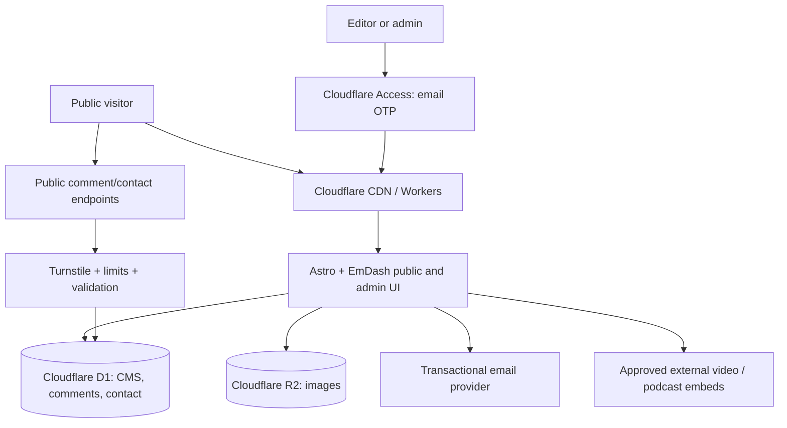

# Arabs Startups — Technical Architecture and Implementation Specification

**Document type:** Developer-ready implementation brief / MVP specification  
**Prepared:** 7 November 2026  
**Status:** Recommended solution, subject to proof-of-concept and security acceptance testing  
**Objective:** A secure, Arabic-first publishing website with editorial staff, email-OTP administration, visitor comments, comment replies, contact messages, and minimal ongoing cost.

## 1. Executive decision

**Recommended stack: Astro + EmDash CMS + Cloudflare Workers + Cloudflare D1 + Cloudflare R2 + Cloudflare Access email OTP.**

Use **EmDash 1.x** (a production-released open-source Astro CMS) rather than building an article editor, publishing workflow, media library, comment moderation, and role system from zero. Add a small custom **Contact Inbox** and any missing **editorial reply** capabilities. Use **Cloudflare Access One-Time PIN** to meet the requirement that authorized staff log in using a numeric code delivered by email. No staff password login or public staff self-registration.

**Practical cost target:** Aim for near-zero on a test instance. Budget approximately **$5/month for Workers Paid** in production, plus the already-owned domain and any outbound email/mailbox upgrades. Cloudflare Workers Free has a **10 ms CPU per dynamic request** limit; an open EmDash issue reports intermittent admin errors at this limit. Treat the paid plan as a reliability allowance, not as an optional promise of zero hosting cost.

**Avoid at launch:** WordPress/PHP servers, Kubernetes, separate application VMs, custom video streaming, paid search, paywall/membership systems, and building a custom CMS from scratch.

### Essential compatibility warning

EmDash's Cloudflare Access adapter uses **Access as its exclusive production login mechanism**. Native EmDash email invitations and magic-link login are **not available** in this mode. Staff provisioning therefore requires Cloudflare Access authorization plus an EmDash local role. It can be managed in two safe administrative steps at launch; a one-screen user-management integration may be built later.

The EmDash REST API includes public comment submission routes under `/_emdash/api/comments/...`, while its Access integration recommends protecting `/_emdash/*`. **Do not deploy a blanket Access rule without designing and testing an exception for the narrowly defined public comment endpoints**. The exception must never expose private administration routes.

## 2. Functional scope

### Public website — MVP

| Feature | Behavior | Priority |
|---|---|---|
| Arabic-first website | Mobile-first, proper RTL, accessible design | Must |
| English | Optional translated UI/content with language switcher | Must support; English content may launch gradually |
| Homepage | Hero, latest stories, features, media series, contact CTA | Must |
| News and articles | Public article pages, categories, tags, authors, search, sharing, SEO | Must |
| Founder stories | Article/interview templates with guest credits | Must |
| Webinars and podcasts | External video/audio embeds, episode metadata | Must |
| Comments | Visitor name/email/comment, moderation before publication | Must |
| Threaded replies | Editorial team can reply to reader comments, publicly visible after approval | Must |
| Contact Us | Form submits to an admin inbox, with optional email alert | Must |
| News/story submission | Dedicated contact category or form | Must |
| About / policies | About, Privacy, Terms, Editorial Policy, Corrections, Disclosure | Must |
| Newsletter | Optional opt-in with explicit consent | Later |
| Startup ecosystem directory | Profiles and filters; separate schema | Later |
| Advertiser portal, paywall | Sponsorship products/payments | Later |

Never show empty sections for media formats that have not yet launched.

### Content-management dashboard — MVP

Staff should be able to:

1. Create, edit, preview, schedule, publish, and unpublish articles without a developer.
2. Save drafts, use revision history, set SEO fields, categories, tags, cover images, author/byline, and article language.
3. Embed a YouTube, LinkedIn, Spotify, or other approved media URL without hosting the original file.
4. View comments by `pending`, `approved`, `spam`, or `deleted/trashed` status; approve, reject, and respond.
5. Reply to a reader as **Arabs Startups Editorial Team** or as a named author; retain the correct parent comment relationship.
6. See new contact/news-submission messages in an inbox; filter, mark read, assign, archive, and reply by email if configured.
7. For administrators: manage editorial user roles, disable users, and trigger access revocation.
8. Review an audit trail of privileged changes and publication actions.

EmDash provides much of items 1–4 and 7 natively; **contact inbox, contact-message response, and any gaps in staff replies or account provisioning need small custom functionality**. Do not assume a feature exists merely because comments are threaded in the public API; verify the moderator UI against the acceptance tests.

## 3. Component selection

| Layer | Recommended technology | Purpose |
|---|---|---|
| Public UI and routes | Astro + TypeScript | SEO-friendly, fast media site |
| CMS | EmDash 1.x with the Cloudflare Blog template | Editing, revisions, scheduling, media, roles, comments |
| Hosting/edge | Cloudflare Workers + static assets/CDN | Public delivery, dynamic API, admin UI |
| Data | Cloudflare D1 (SQLite) | CMS data, comments, users, contact inbox |
| Images/files | Cloudflare R2 (Standard class) | Photos, graphics, thumbnails; avoid large video |
| Editorial staff sign-in | Cloudflare Zero Trust Access + One-Time PIN | Numeric email-code login, identity allowlist |
| CMS authorization | EmDash roles and server-side checks | Contributor / Author / Editor / Admin permissions |
| Human verification | Cloudflare Turnstile | Public contact and comment forms, server-side verification |
| Outbound messages | Resend or configured EmDash email transport | Contact notifications, replies, operational emails |
| Source and deployments | Dedicated GitHub organization/repo + CI/CD | Code ownership, version review, deployment |
| Video/audio | YouTube, LinkedIn, podcast platform embeds | Avoid video/audio hosting and bandwidth charges |
| Metrics | Cloudflare Web Analytics | Privacy-conscious traffic measurement |

### Why EmDash rather than Pages CMS

Pages CMS is excellent for static Git-backed publishing, but this project now needs a **living editorial admin, user roles, moderation, comment replies, and incoming inquiries**. EmDash already includes database-backed publishing and a moderation interface; the remaining custom surface is smaller. EmDash 1.0 was released in September 2026, so pin a tested patch version and maintain a patch/update process instead of blindly deploying `latest` to production.

## 4. Architecture

### Security boundaries

- **Public:** `/`, `/news`, `/stories`, `/webinars`, `/podcasts`, `/contact`, published article pages, static assets, approved media.
- **Admin-only:** `/_emdash/admin/*`, all EmDash settings/user/content management endpoints, and private contact-inbox/admin-reply routes.
- **Public comments:** Only the EmDash-documented public `GET` and `POST` endpoints, or preferably a tiny, explicitly defined public gateway that enforces Turnstile and forwards safely to the CMS comment service.
- **Never public:** `/_emdash/api/admin/*`, draft previews, private media, audit logs, account management, backups, API tokens, and contact-message lists.

**Required development proof-of-concept:** Confirm that a protected `/_emdash/*` Access application can coexist with *exactly* the public commenting functions. One approach is a more-specific public Access bypass for `/_emdash/api/comments/*`, since the documented operations at that prefix are for public list/create; verify the installed EmDash version's OpenAPI inventory and do not bypass any broader prefix. Rate-limit and protect writes at origin, not only through a visible widget. Do not use this bypass if it exposes additional privileged operations. An alternate approach is a purpose-built `/api/public-comments` gateway while keeping the original CMS endpoint protected. This needs an integration test before release.

The CMS admin must remain accessible after adding the comment exception, and the anonymous visitor must never receive admin data or a valid staff session.

## 5. Identity, OTP login, and user lifecycle

### User roles

| Role | May create content | Publish content | Moderate / reply | Manage users/configuration |
|---|---|---|---|---|
| Public visitor | No | No | Submit moderated comment only | No |
| Contributor | Own drafts | No | No by default | No |
| Author | Own posts | Own posts | Editorial policy-dependent | No |
| Editor | All posts | Yes | Yes | No |
| Admin | All posts | Yes | Yes | Yes |

Use EmDash native roles: `Contributor` (20), `Author` (30), `Editor` (40), `Admin` (50). For a small publication, start with one primary admin, one backup admin, one editor, and contributors only as needed. Implement private message access as an explicit `Editor/Admin` permission checked server-side.

### Required staff login UX

1. Staff member visits the admin login entry point (the protected EmDash admin URL).
2. Cloudflare Access asks for an approved email address.
3. Cloudflare sends a single-use numeric one-time PIN to that mailbox.
4. Staff member enters the code and completes the Access flow.
5. EmDash verifies the signed Access JWT and the locally assigned role before displaying the dashboard.
6. Session expiry/reauthentication follows a short, documented Access application policy. Users can log out.

**No password-based staff login. No public signup.** OTP authenticates mailbox possession; it is **not the same as phishing-resistant MFA**. Require strong MFA and recovery protection on every staff email account and on Cloudflare/GitHub administrator accounts. Cloudflare OTP delivery must be enabled explicitly on a new Zero Trust organization; the Cloudflare-account login is now the default IdP.

### Administrator adding and revoking users

**Working launch process (two-step; safe and simple):**

- **Add:** An Access administrator allowlists the staff email in the dedicated Arabs Startups Access application/policy. When the user signs in, EmDash can auto-provision their account at the minimum editorial role (`Contributor` recommended). A CMS admin upgrades the role to Author/Editor as approved.
- **Remove:** Immediately remove the user's email from the Access allowlist and disable the local EmDash account. Terminate/revoke active Access sessions where supported and ensure the local disabled-user check blocks further operations. Audit the action.
- **Change role:** Admin modifies the EmDash role. If group-to-role sync is in use, update the group assignment too; do not leave conflicting authorities.
- **Bootstrap:** Restrict the first account to the named company owner/administrator, finish setup immediately, confirm it has Admin role, create a verified backup administrator, and disallow broad email-domain access.

**Important:** EmDash's built-in "Invite User" flow is disabled in production when its Cloudflare Access auth adapter is enabled. Do not promise an in-CMS invitation button in this mode. If single-screen Add/Remove is mandatory, implement a small **Team Access** admin extension using a *minimally scoped* Cloudflare API token, with role checks, CSRF protection, allowlisted policy targets, audit events, safe error handling and two-step recovery. Treat this as an extra task beyond the base CMS setup.

## 6. Publishing workflow

### Content model

Use EmDash content collections and taxonomies:

- `posts`: title, slug, excerpt, rich body, category, tags, featured image, author/byline, publication status/datetime, SEO data, optional source links and sponsored label.
- `pages`: About, editorial standards, contact/privacy/terms, disclosures.
- `episodes`: webinar/podcast content with type, title, description, date, guest name(s), provider URL, embed URL, transcript/notes, featured image, SEO metadata. Can be introduced as a dedicated EmDash collection or represented with post categories initially.
- `partners` / `ecosystem_entities`: deferred until enough verified information exists to justify a directory.

Editorial states: **Draft → In Review → Published → Updated/Archived**, with scheduled publication available. Native EmDash roles and drafts already cover most operations; implement an explicit "In Review" marker/taxonomy and approval notification if a formal review queue is required.

### Publishing acceptance test

A contributor logs in via email OTP, drafts an Arabic article, adds a cover image, previews it, and requests review. An editor reviews, publishes and later edits it. The page is publicly accessible and SEO tags/RSS update. A visitor cannot read drafts or edit content. The editor's published change appears without manually editing GitHub or rebuilding the site.

### Language and SEO

Configure Astro/EmDash with `ar` as the default locale and `en` as a secondary locale. Use default-locale-unprefixed routing (e.g., `/news/...` for Arabic and `/en/news/...` for English), as recommended for EmDash admin compatibility. Render Arabic text with `lang="ar" dir="rtl"`, correct LTR inline handling, editorial fonts that support Arabic, and translated menus. Include canonical URLs, `hreflang`, sitemaps, RSS, Open Graph, article dates, and structured data where appropriate.

## 7. Comments, moderation and staff replies

### Visitor flow

1. Visitor opens a published story and views **approved comments only**.
2. Visitor clicks "Leave a comment" or "Reply".
3. Form asks for display name, email (kept private), and message; a privacy/comment-policy notice is displayed.
4. Challenge/rate limit is applied. Validate Turnstile server-side if used; never trust a browser-only check.
5. Store comment as `pending` by default and show "Thanks — awaiting review". Do not auto-publish anonymous comments in the initial launch.
6. Editor approves, marks as spam, or removes it from the moderation interface.
7. Approved comment appears in the correct article/reply thread. Show a clear "Editorial Team" badge for staff replies.

The public never sees commenter emails, private moderation notes, IP hashes, or pending comments.

### Replies

- **Visitors:** May reply to existing approved comments. All visitor replies are pending moderation.
- **Editors/Admins:** May reply to comments as the publication; store `parent_comment_id`, staff account ID, and audit metadata, then publish with the appropriate moderation rules.
- **MVP fallback:** EmDash already exposes threaded comments and moderation, but if the installed admin UI lacks a native "Reply as staff" action, build a small authenticated reply form or native admin extension. Treat this as a required acceptance criterion, not an assumed feature.
- **Notifications:** Optional email alert for new pending comments and optional reply notification to the original commenter, only when appropriate consent/legal basis exists.

### Spam and safety

Use body size limits, HTML stripping/plain-text rendering, link-count limits, duplicate detection, server-side Turnstile verification, per-IP and per-email throttling, and manual moderation. Disallow arbitrary HTML/JavaScript and attachments in comments. Maintain a moderation log and an abuse/report channel. Use a consistent takedown process for personal data or defamatory content.

## 8. Contact form, inbound messages, and replies

### Public form

- **Fields:** Full name, email, subject, message, category (`General`, `News Tip`, `Founder Story`, `Event/Webinar`, `Media Partnership`, `Correction`), optional organization/URL.
- **Validation:** Server-side email validation, limits, Turnstile validation, rate limiting, CSRF/origin checks, and safe handling of links/HTML.
- **Response:** Thank-you confirmation with no promise of response time or publication.
- **Privacy:** Purpose notice and a link to Privacy Policy. No automatic newsletter enrollment.

### Admin contact inbox — small custom extension

Create an `inquiries` D1 table or EmDash-compatible secure data collection containing:

`id, name, email, subject, category, message, organization, status, assigned_editor_id, created_at, updated_at, responded_at, retention_due_at`.

**Statuses:** `new`, `in_progress`, `responded`, `closed`, `spam`. Every message is private, visible to authorized Editor/Admin only. The admin dashboard provides list/detail/filter/search, ownership, internal notes, archive/delete, CSV export on admin authorization, and a **Reply by Email** action.

**Outbound contact reply:** Use a verified transactional sender such as `hello@<your-domain>` through Resend or the configured email transport. Set `Reply-To` to the publication's valid receiving inbox, not a nonexistent mailbox. Sanitize the original inquiry; never include private internal notes. Record a timestamp and provider message ID, but do not unnecessarily store raw authentication credentials or full email provider logs.

**Receiving email replies:** Owning a domain does not mean mailboxes already exist. Configure a real receiving mailbox or a forwarding service (for example, Cloudflare Email Routing) for the chosen public contact address. Inbound replies to that mailbox will **not automatically appear** in the website dashboard unless an explicit inbound email integration is added. The v1 inbox stores **website form submissions**, not every external email.

**Alerting:** Send a compact email notification to an editorial address on new inquiries and optionally on pending comments, with links to the protected dashboard rather than full private-message text. Make alerts opt-in per team member and throttle notifications.

## 9. Security baseline — non-negotiable

### Platform security

- Enable HTTPS-only, HSTS after verification, TLS, bot protections, and sensible Cloudflare WAF rules.
- Separate company-owned Cloudflare account, DNS, GitHub repo, billing and email identity; avoid mixing with CloudSoftway/Hub63 environments unless formally contracted.
- Use the EmDash Cloudflare Access JWT validation adapter, not a client-side "isLoggedIn" flag.
- Protect every privileged REST route, import/export, backup, preview, plugin route and admin asset requiring authenticated data.
- Review the **public comment path exception** and verify it exposes no privileged functions.
- Make all authorization decisions on the server. Log and reject unauthorized role changes, API requests and editor replies.
- Use secure session cookie defaults; short-lived Access sessions, logout, and immediate disablement tests.
- Keep `EMDASH_ENCRYPTION_KEY`, mail provider secrets, Cloudflare API tokens and other secrets in Worker runtime secrets; never in code, GitHub or exposed browser variables.
- Limit production deployment rights to a small set of maintainers; require review before production merges.

### Application security

- Validate every input server-side with strict schemas, lengths, allowed URL protocols, and database parameterization.
- Escape or sanitize user content in comment rendering, email templates, editorial embeds and contact inbox.
- Use a restrictive Content Security Policy while allowlisting necessary video providers and the Turnstile challenge; avoid unsafe inline script concessions where possible.
- Protect state-changing authenticated endpoints against CSRF, and check origins on public writes.
- Turnstile must be checked with Cloudflare's Siteverify endpoint on the server. Check `success`, expected action and hostname; tokens are single-use and expire after 5 minutes.
- Separate rate limits for login/OTP requests, comments, contact, replies and uploads; return generic responses that do not expose whether staff emails exist.
- For uploads: allow images and PDFs only if necessary; enforce MIME validation, size caps, storage quotas and malware review as appropriate. Avoid user-submitted SVG and executable file types.
- Publicly serve **only intentional media**. If using an R2 public domain, isolate backups/private uploads in a **different private bucket** and exclude any private paths.
- Pin and update dependencies, limit plugins, and review every installed plugin's capabilities. Do not allow a content manager to install untrusted plugins.
- Use a dedicated staging environment with separate D1 and R2 resources; never test against production records.

### Privacy and backups

- Collect the minimum personal information for contact/comment operations; publish clear privacy and retention notices.
- Define deletion/retention windows for inquiries and moderated comments, with a documented data access/deletion process.
- Back up D1 and R2 regularly (daily if possible), retain encrypted/offsite copies in a private destination, and test a full restore at least quarterly.
- Keep an audit trail for publication, moderation, admin access, permission changes and contact replies; avoid logging OTPs, secrets or entire message bodies.
- Verify the legal requirements for personal data handling and media rights in the jurisdictions where the company operates and serves users.

### Security warning

**Email OTP is convenient but relies entirely on the security of the mailbox.** For Admin/Editor roles, require mailbox MFA; ideally also allow a more phishing-resistant method when the stated OTP-only requirement can be relaxed. Admin actions with high impact (new Admin, export contact lists, change Access policy) should require a fresh authentication check and be audited.

## 10. Cloudflare Access policy design

- Create a **dedicated Access application** for Arabs Startups administrative paths.
- Only named staff email addresses are allowed; **never** use `Allow Everyone`, an unrestricted domain wildcard, or a publicly exposed admin route.
- Enable Cloudflare **One-Time PIN** as the login method; Cloudflare sends the numeric email code.
- Protect `/_emdash/*` as EmDash documents, not only `/_emdash/admin/*`.
- Handle public comment GET/POST routes through a narrow, tested exception/proxy. Make sure a broad bypass does not expose the protected `/_emdash/api/admin/*` namespace.
- Map Access identity to local EmDash users with `autoProvision` and the lowest usable role; keep `syncRoles` disabled if role assignments are administered in EmDash, otherwise configure explicit and tested group-based role mapping.
- Revoke both the Access allowlist authorization and local EmDash account when a staff member leaves.
- Test revoked session behavior; do not assume removing an allowlist entry instantly terminates already-issued access cookies without session revocation or expiry.

## 11. Implementation milestones

### Milestone A — Secure technical proof-of-concept

- Scaffold EmDash from the Cloudflare **Blog** template and pin a tested version.
- Deploy to a nonproduction subdomain; connect D1, R2, Workers, and runtime secrets.
- Prove Cloudflare Access email OTP login for a named admin, unauthenticated public viewing, denied access for nonallowlisted email, and properly restricted admin APIs.
- Prove that public comment create/read works in a separate incognito browser **without** weakening admin protection.
- Test 10+ routine editor/admin operations under the chosen Workers plan. If Workers Free shows CPU 503 errors, use Workers Paid before launch.

### Milestone B — Public editorial website

- Implement brand-responsive Arabic-first layouts, RTL typography, localized routes and menus.
- Configure News, Stories, Webinar/Podcast and Page content templates.
- Publish first real articles, validate SEO, RSS, sitemap, embeds and sharing.
- Implement only needed categories to avoid empty or thin content.

### Milestone C — Engagement and team workflows

- Activate comments, manual moderation, public replies and editorial replies.
- Build contact form and private contact inbox with a reply action.
- Configure email sending/receiving and notification preferences.
- Set up 1 admin, 1 backup admin, content managers and contributors.
- Implement two-step access management, or add a scoped Team Access panel if one-screen provisioning is required.

### Milestone D — Production hardening and launch

- Security testing, no-public-draft tests, spam tests, content sanitization and privilege escalation checks.
- Configure policy pages, privacy rules, backups, restore rehearsal, monitoring, audit and incident contacts.
- Perform mobile Arabic UX tests and editorial-team walkthroughs.
- Switch the owned domain, monitor errors, and review budgets and limits after traffic starts.

## 12. Definition of Done / test checklist

- [ ] The live website loads over HTTPS with correct Arabic RTL behavior on mobile and desktop.
- [ ] Visitors can read articles without logging in; drafts are inaccessible.
- [ ] Every authorized CMS user logs in through a **numeric email OTP**; a random address cannot create an editor account.
- [ ] Non-allowed users cannot see admin pages **or access privileged APIs**.
- [ ] An Admin can add a permitted editor via the documented onboarding procedure and revoke all of that person's access.
- [ ] Contributors cannot publish without permission; editors can publish and revert their changes.
- [ ] Editors can upload images, tag posts, schedule publications and manage bylines.
- [ ] Visitors can post article comments without an account, and the public sees only approved comments.
- [ ] Editors can reply publicly to comments, with a visible staff identity and proper threading.
- [ ] Comment and contact spam prevention is enforced **server-side**; bypassing JavaScript does not bypass validation.
- [ ] The contact form stores messages privately; Editors/Admins can read, manage and reply to them.
- [ ] Non-admin staff cannot export private contact data or manage users.
- [ ] Email addresses from comments/contact forms are never exposed publicly.
- [ ] Existing staff access becomes ineffective after disable/revocation, including existing sessions according to policy.
- [ ] Production has working backups, a tested restore, monitoring and approved ownership.
- [ ] No customer/editor personal data from this media business is silently shared with Hub63 or CloudSoftway.

## 13. Cost and scaling assumptions (November 2026)

| Service | Small-site target | Notes |
|---|---:|---|
| Astro + EmDash software | $0 licensing | Open-source; development/maintenance effort still required |
| Cloudflare Workers Free | $0 | 100,000 Worker requests/day; **10 ms CPU per request**, risky for EmDash admin |
| Cloudflare Workers Paid | **from ~$5/month** | Practical recommended production baseline; additional usage charges apply |
| Cloudflare D1 | Usually $0 within included usage | Free tier: 5 million rows read/day, 100,000 rows written/day, 5 GB total storage |
| Cloudflare R2 Standard | Usually $0 within included usage | Free tier: 10 GB-month, 1 million Class A, 10 million Class B operations/month |
| Cloudflare Access Free | $0 for up to 50 users | Subject to plan conditions |
| Cloudflare Turnstile | $0 on free plan | Server-side verification mandatory |
| Resend transactional mail | $0 up to 3,000 emails/month | 100 emails/day on free plan; larger usage may require paid |
| Domain | Already owned | Renewal separate from website cost |
| Inbound email mailbox | $0–variable | Forwarding may be free; a real reply-capable mailbox may cost extra |
| Video/audio | $0–variable | External provider free tiers and content policy limitations apply |

**Budget expectation:** ~$5/month baseline production infrastructure, plus domain renewal, any mailbox, labor and usage above free-tier limits. Free-tier operation should be treated as a test result, **not a security or reliability guarantee**.

### Capacity triggers

Upgrade when CPU errors appear, Workers/D1/R2 consumption approaches limits, mail delivery exceeds 100/day, uploads exceed free storage, editorial workflow needs more advanced approval rules, or the site introduces full-text search at scale, high-traffic dynamic pages, large media assets, or advanced real-time memberships.

## 14. Known design choices and open verifications

1. **Exact domain:** Already owned by the founders; use it in DNS/config only when provided. Do not fabricate the hostname.
2. **Formal ownership:** Confirm legal ownership and editorial disclosure before the public About/legal pages go live.
3. **Admin/OTP:** Cloudflare Access's adapter disables native EmDash production invitations; keep the 2-step provisioning process or develop a small custom admin panel.
4. **Comment API vs Access:** Security-critical integration test required before launch. The public comment exception must not expose private endpoints.
5. **Editor reply UI:** Verify in the installed EmDash build; add the small missing interface if needed.
6. **Receiving replies:** Website form inbox is not an email inbox. Integrate a receiving mailbox and inbound routing only if needed.
7. **Cloudflare Workers Free:** Test CPU under real editorial usage; budget Workers Paid if necessary.
8. **Staging and production:** Separate data, buckets, Access apps, secret keys, and resources.

## 15. Official references and background

**Technology documentation**

- EmDash 1.0 announcement: https://blog.cloudflare.com/emdash-cms-plugin-registry
- EmDash blog template and comment support: https://docs.emdashcms.com/guides/create-a-blog/
- EmDash admin UI: https://docs.emdashcms.com/concepts/admin-panel/
- EmDash authentication and Cloudflare Access caveats: https://docs.emdashcms.com/guides/authentication/
- EmDash Cloudflare deployment: https://docs.emdashcms.com/deployment/cloudflare/
- EmDash public comment REST API: https://docs.emdashcms.com/reference/rest-api/
- EmDash comment components: https://docs.emdashcms.com/reference/api/
- EmDash localization: https://docs.emdashcms.com/guides/internationalization/
- Cloudflare Access email OTP: https://developers.cloudflare.com/cloudflare-one/integrations/identity-providers/one-time-pin/
- Cloudflare Access JWT and policies: https://developers.cloudflare.com/cloudflare-one/access-controls/applications/http-apps/authorization-cookie/
- Cloudflare Turnstile server verification: https://developers.cloudflare.com/turnstile/get-started/server-side-validation/
- Cloudflare Workers limits: https://developers.cloudflare.com/workers/platform/limits/
- Cloudflare D1 pricing: https://developers.cloudflare.com/d1/platform/pricing/
- Cloudflare R2 pricing: https://developers.cloudflare.com/r2/pricing/
- Cloudflare Zero Trust pricing: https://www.cloudflare.com/plans/zero-trust-services/
- Resend free email limits: https://resend.com/pricing
- EmDash Workers Free CPU issue (October 2026): https://github.com/emdash-cms/emdash/issues/4218

**Internal context**

- Hub63 Weekly Alignment, 7 November 2026: https://fathom.video/calls/891517326
- Arabs Startups planning, 2 November 2026: https://fathom.video/calls/885245020
- Sy Incubator Alignment, 17 October 2026: https://fathom.video/calls/864039035

---

**Bottom line:** Do not build a bespoke newsroom CMS. Deploy EmDash on Cloudflare, secure staff with Access email OTP, keep public comments and contacts properly validated/moderated, add only a small contact-inbox and any missing reply/admin-integration pieces, and budget ~$5/month for production reliability.
